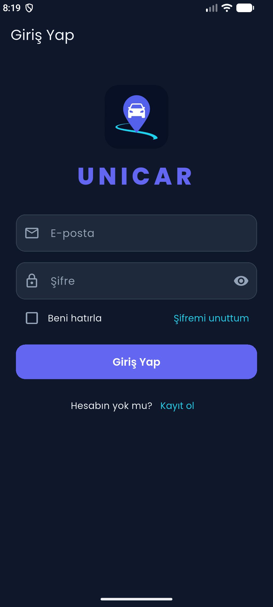
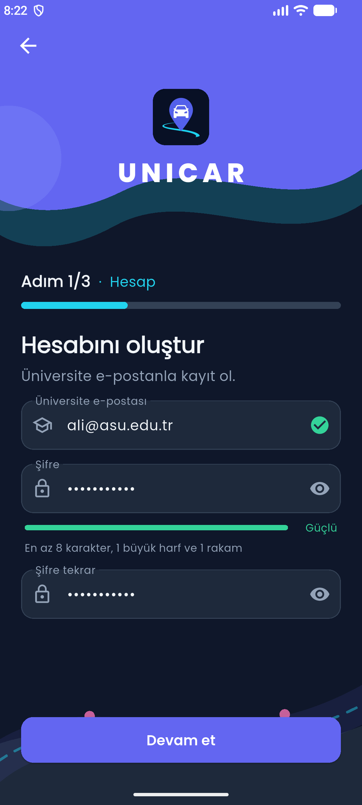
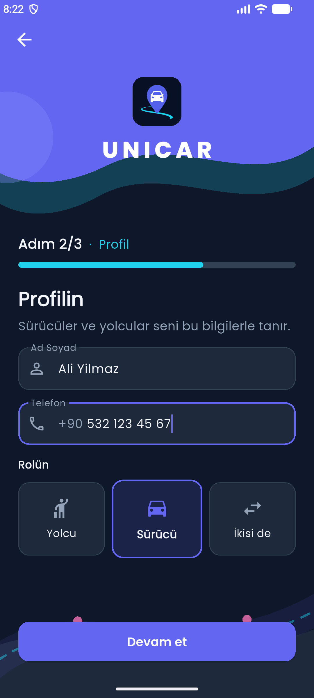
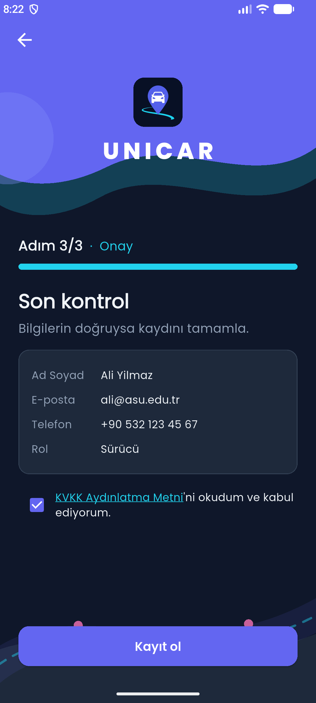
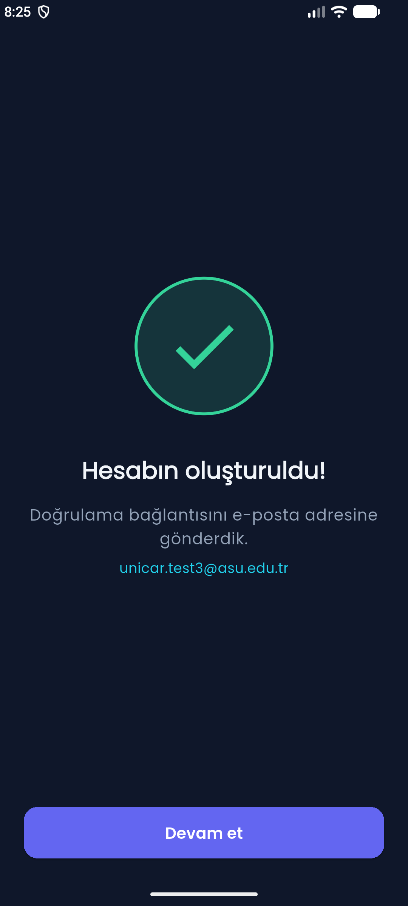
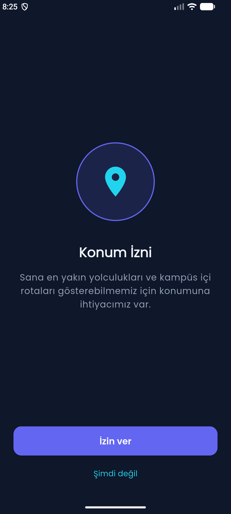
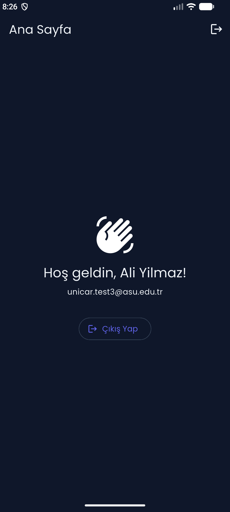
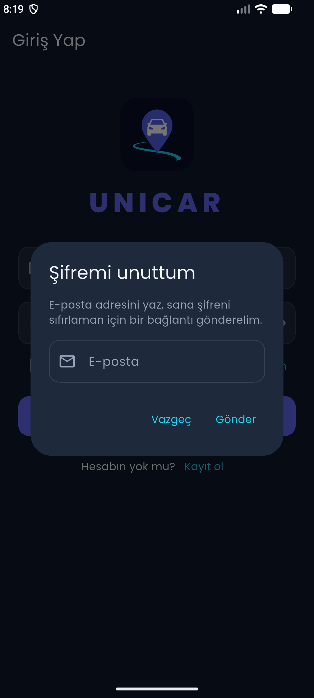
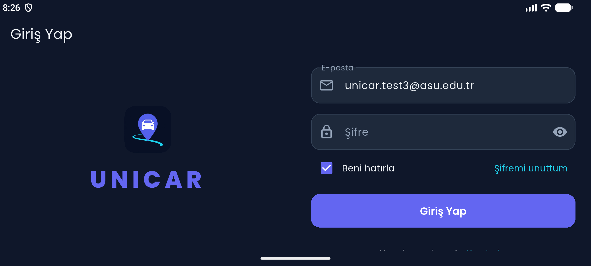
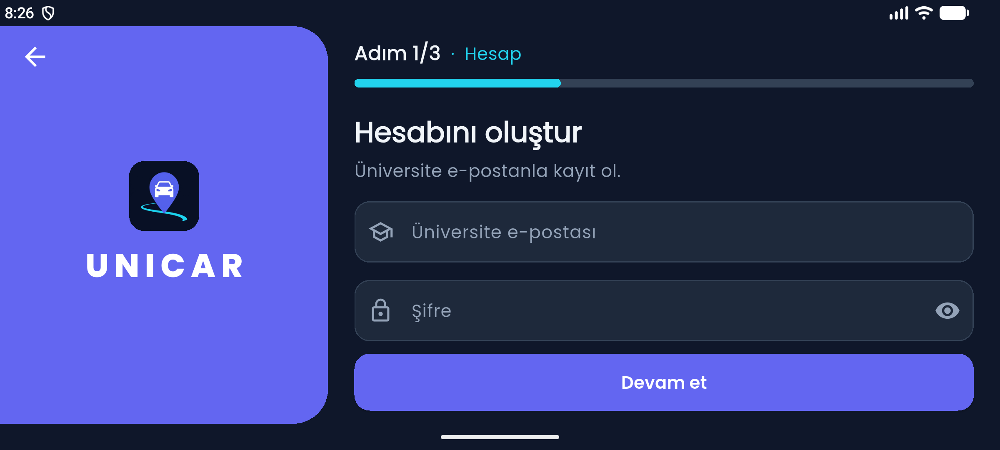

# UNICAR – Kampüs Araç Paylaşım Uygulaması

Aksaray Üniversitesi öğrencilerinin kampüs içi ve çevresindeki yolculukları
paylaşabilmesi için geliştirilen Flutter uygulaması. Bu sürümde uygulamanın
**kayıt, giriş ve hesap güvenliği** bölümü tamamlanmıştır.

> **Mobil Programlama dersi proje ödevi**
> Süveyda Şeyma Mercan – 240211001
> Aksaray Üniversitesi, Yazılım Mühendisliği 3. sınıf

---

## Hızlı deneme

### 1) Hazır APK ile (en kolay yol)
[**Releases**](../../releases/latest) sayfasından `UNICAR.apk` dosyasını bir
Android telefona indirip kurabilirsiniz. Kurulum sırasında "bilinmeyen
kaynaklardan yüklemeye izin ver" onayı istenebilir.

### 2) Demo e-posta adresleri
Kayıt yalnızca **`@asu.edu.tr`** uzantılı ve **okul listesinde kayıtlı**
e-postalarla yapılabilir. Deneme için listeye şu adresler eklenmiştir:

| Kayıt için kullanılabilecek e-posta |
|---|
| `unicar.test1@asu.edu.tr` |
| `unicar.test2@asu.edu.tr` |
| `unicar.test3@asu.edu.tr` |

Her adres **bir kez** kayıt olabilir. Kayıttan sonra aynı adres ve
belirlediğiniz şifreyle giriş yapabilirsiniz. Listede olmayan bir
`@asu.edu.tr` adresi denendiğinde "Bu e-posta okul kayıtlarında bulunamadı"
uyarısı görünür.

> Not: Bu adreslerin gerçek bir posta kutusu yoktur. Bu nedenle e-posta
> doğrulaması teslim sürümünde kapalıdır (bkz. [Bilinen sınırlar](#bilinen-sınırlar)).

---

## Ekran görüntüleri

| Giriş | Kayıt – Hesap | Kayıt – Profil | Kayıt – Onay |
|---|---|---|---|
|  |  |  |  |

| Kayıt başarılı | Konum izni | Ana sayfa | Şifremi unuttum |
|---|---|---|---|
|  |  |  |  |

Yatay ekran:




---

## Özellikler

**Kayıt (3 adım)**
- **Hesap:** `@asu.edu.tr` e-postası (okul listesi kontrolü), şifre gücü
  çubuğu (zayıf / orta / güçlü), şifre tekrarı
- **Profil:** Ad Soyad (Türkçe karakter destekli), telefon (`+90 5XX XXX XX XX`
  biçiminde otomatik), rol seçimi (Yolcu / Sürücü / İkisi de)
- **Onay:** Bilgi özeti, KVKK aydınlatma metni ve onayı

**Giriş**
- "Beni hatırla": işaretlenmezse uygulama her açılışta oturumu kapatır
- "Şifremi unuttum": e-postaya şifre sıfırlama bağlantısı gönderilir

**Diğer**
- Kayıt sonrası konum ve bildirim izin ekranları
- E-posta doğrulama ekranı (yeniden gönder / kontrol et)
- Türkçe hata mesajları (internet yok, e-posta kayıtlı vb.)
- Çift tıklamaya karşı korumalı butonlar
- Koyu tema, Poppins yazı tipi
- Dikey ve yatay ekran desteği
- Animasyonlar (yalnızca Flutter'ın kendi widget'larıyla): `Hero`,
  `AnimatedContainer`, `AnimatedSwitcher`, `ScaleTransition`,
  `FadeTransition`, `TweenAnimationBuilder`

---

## Kullanılan teknolojiler

| Teknoloji | Kullanım amacı |
|---|---|
| Flutter 3.47 / Dart 3.13 | Uygulama |
| Firebase Authentication | Kayıt, giriş, şifre sıfırlama, e-posta doğrulama |
| Cloud Firestore | Kullanıcı profilleri ve okul e-posta listesi |
| `google_fonts` | Poppins yazı tipi |
| `hexcolor` | Renk paleti |
| `flutter_svg` | Kayıt ekranı arka planı |
| `permission_handler` | Konum ve bildirim izinleri |
| `shared_preferences` | "Beni hatırla" tercihi |
| `flutter_localizations` | Türkçe dil desteği |

---

## Klasör yapısı

```
lib/
├── main.dart                      Uygulama girişi, tema, açılış yönlendirmesi
├── firebase_options.dart          Firebase bağlantı ayarları
├── models/
│   └── user.dart                  Kullanıcı modeli ve roller
├── services/
│   ├── auth_service.dart          Firebase işlemleri ve Türkçe hata mesajları
│   └── remember_me_service.dart   "Beni hatırla" tercihi
├── screens/
│   ├── login_screen.dart          Giriş
│   ├── register_screen.dart       3 adımlı kayıt
│   ├── register_success_screen.dart
│   ├── permission_screen.dart     Konum / bildirim izni
│   ├── verify_email_screen.dart   E-posta doğrulama
│   └── home_screen.dart           Ana sayfa
├── widgets/                       Tekrar kullanılan arayüz parçaları
└── utils/
    ├── validators.dart            Form doğrulama kuralları
    ├── app_colors.dart            Renk paleti
    ├── app_config.dart            Özellik bayrakları
    ├── embedded_images.dart       Koda gömülü görseller
    └── phone_input_formatter.dart Telefon biçimlendirme
```

Mimari üç katmandan oluşur: **ekranlar** yalnızca **`AuthService`**'i çağırır,
Firebase ile yalnızca servis konuşur. Böylece Firebase'e ait kod ve hata
çevirileri tek bir yerde toplanır.

---

## Görseller neden kodun içinde?

Proje teslimi yalnızca **`lib` klasörünü** kapsamaktadır. Logo ve kayıt ekranı
arka planı normalde `assets/` klasöründe durur ve `lib` dışında kalır; bu
durumda `lib` tek başına açıldığında görseller bulunamazdı.

Bu nedenle iki görsel doğrudan Dart koduna gömülmüştür
([`lib/utils/embedded_images.dart`](lib/utils/embedded_images.dart)):

- **Arka plan (SVG):** SVG bir metin dosyası olduğu için olduğu gibi
  yazılmış, `SvgPicture.string(...)` ile çizilir.
- **Logo (PNG):** İkili bir dosya olduğu için Base64 metnine çevrilmiş,
  `Image.memory(base64Decode(...))` ile gösterilir. Ekranda en fazla 96 dp
  gösterildiği için 384×384 piksele küçültülmüştür (306 KB → 51 KB).

`assets/` klasörü kaynak dosyalar ve uygulama ikonunun üretilmesi
(`flutter_launcher_icons`) için korunmuştur.

---

## Firebase yapısı

| Yer | İçerik |
|---|---|
| Authentication | E-posta, şifre (Firebase tarafından güvenli şekilde saklanır), doğrulama durumu |
| Firestore `users/{uid}` | adSoyad, email, telefon, rol, kvkkOnay, olusturmaTarihi |
| Firestore `izinli_mailler/{email}` | Okulun öğrenci e-posta listesi (örnek) |

Güvenlik kuralları:

```
match /users/{userId} {
  allow read, write: if request.auth != null && request.auth.uid == userId;
}
match /izinli_mailler/{email} {
  allow get: if true;
  allow list, write: if false;
}
```

- Her kullanıcı yalnızca kendi profilini okuyup yazabilir.
- Okul listesi tek tek sorgulanabilir ama tamamı indirilemez ve uygulamadan
  değiştirilemez.

> Depodaki `google-services.json` ve `firebase_options.dart` dosyalarında yer
> alan Firebase API anahtarı gizli bir parola değil, uygulamanın Firebase
> projesini tanımlayan bir kimliktir. Verilere erişim yukarıdaki güvenlik
> kurallarıyla sınırlandırılmıştır.

---

## Projeyi çalıştırma

```bash
git clone <bu deponun adresi>
cd unicar
flutter pub get
flutter run
```

Gereksinimler: Flutter 3.47+, Android SDK (compileSdk 37), Android emülatör
veya telefon. Firebase yapılandırması depoda hazırdır; ek bir kurulum
gerekmez. Firebase yalnızca **Android** için yapılandırılmıştır.

Testler: `flutter test`

---

## Bilinen sınırlar

- **E-posta doğrulaması kapalı:** Doğrulama ekranı ve kodu hazırdır; ancak
  demo adreslerin gerçek posta kutusu olmadığı için teslim sürümünde
  [`lib/utils/app_config.dart`](lib/utils/app_config.dart) içindeki
  `requireEmailVerification` bayrağı `false` yapılmıştır. `true` yapıldığında
  doğrulanmamış kullanıcılar Ana Sayfa yerine doğrulama ekranını görür.
- **Okul listesi kontrolü uygulama içinde yapılır:** Gerçek bir üründe bu
  kontrolün sunucu tarafında (ör. Firebase Blocking Functions) yapılması
  gerekir.
- **Yalnızca Android:** iOS ve web için Firebase yapılandırması yapılmamıştır.
- **Sonraki adımlar:** Yolculuk oluşturma, yolculuk arama ve sürücü–yolcu
  eşleştirme ekranları.
