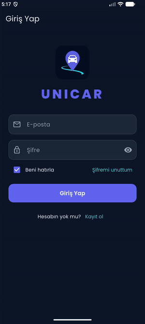

# UNICAR - Kampüs Araç Paylaşım Uygulaması


UNICAR, Aksaray Üniversitesi öğrencilerinin kampüs içinde yolculuk paylaşabilmesi için geliştirilmiş bir Flutter uygulamasıdır. Bu sürümde kayıt, giriş ve hesap güvenliği bölümü tamamlanmıştır.

Mobil Programlama dersi proje ödevi\
Süveyda Şeyma Mercan - 240211001\
Aksaray Üniversitesi, Yazılım Mühendisliği 3. sınıf

<p align="center">
  
</p>

<p align="center">
  
  
  
  
</p>

## Deneme

Uygulama [Releases](https://github.com/MERCANX25/unicar/releases) bölümündeki UNICAR.apk dosyasıyla Android cihazlara kurulabilir. Kurulum sırasında "bilinmeyen kaynaklardan yükleme" izni istenebilir.

Kayıt yalnızca @asu.edu.tr uzantılı ve okul listesinde yer alan e-posta adresleriyle yapılabilir. Deneme için listeye aşağıdaki adresler eklenmiştir:

- unicar.test1@asu.edu.tr
- unicar.test2@asu.edu.tr
- unicar.test3@asu.edu.tr

Her adres bir kez kayıt olabilir. Kayıt sonrası aynı adres ve belirlenen şifreyle giriş yapılabilir. Listede bulunmayan bir adres girildiğinde "Bu e-posta okul kayıtlarında bulunamadı" uyarısı gösterilir.

Bu adreslerin gerçek bir posta kutusu bulunmadığı için e-posta doğrulaması bu sürümde kapalıdır.

## Ekran görüntüleri

Ekran görüntüleri `docs/screenshots` klasöründedir: giriş, kayıt (hesap, profil, onay adımları), kayıt başarılı ekranı, konum izni, ana sayfa, şifremi unuttum ekranı, hata mesajı ve yatay ekran görünümleri.

## Özellikler

Kayıt üç adımdan oluşur:
- Hesap: okul e-postası, şifre (güç göstergeli) ve şifre tekrarı
- Profil: ad soyad, telefon (+90 biçiminde otomatik düzenlenir) ve rol seçimi (Yolcu, Sürücü, İkisi de)
- Onay: girilen bilgilerin özeti, KVKK metni ve onayı

Giriş ekranında "Beni hatırla" seçeneği bulunur. İşaretlenmediğinde uygulama her açılışta oturumu kapatır. "Şifremi unuttum" ile e-posta üzerinden şifre sıfırlama yapılabilir.

Kayıttan sonra konum ve bildirim izinleri için açıklama ekranları gösterilir. Hata mesajları Türkçedir, butonlar çift tıklamaya karşı korunmuştur. Uygulama koyu temada, Poppins yazı tipiyle ve yatay ekranda da çalışacak şekilde tasarlanmıştır.

Animasyonlar yalnızca Flutter'ın kendi widget'larıyla oluşturulmuştur: Hero, AnimatedContainer, AnimatedSwitcher, ScaleTransition, FadeTransition ve TweenAnimationBuilder.

## Kullanılan paketler

- firebase_auth, cloud_firestore: kimlik doğrulama ve veri
- google_fonts: Poppins yazı tipi
- hexcolor: renk paleti
- flutter_svg: kayıt ekranı arka planı
- permission_handler: konum ve bildirim izinleri
- shared_preferences: "Beni hatırla" tercihi

## Proje yapısı

- `lib/main.dart`: uygulamanın başlangıç noktası
- `lib/models/user.dart`: kullanıcı modeli
- `lib/services/`: Firebase işlemleri (`auth_service.dart`) ve "beni hatırla" tercihi
- `lib/screens/`: giriş, kayıt, izin, doğrulama ve ana sayfa ekranları
- `lib/widgets/`: yeniden kullanılan arayüz parçaları
- `lib/utils/`: doğrulama kuralları, renk paleti ve gömülü görseller

Ekranlar Firebase'e doğrudan bağlanmaz; tüm Firebase işlemleri `auth_service.dart` üzerinden yapılır.

## Görsellerin koda gömülmesi

Proje yalnızca `lib` klasörüyle teslim edilmektedir. Logo ve arka plan normalde `assets` klasöründe bulunur ve `lib` tek başına açıldığında görünmez. Bu nedenle arka plan SVG'si ve logo `lib/utils/embedded_images.dart` dosyasına gömülmüştür. Logo, ekranda gösterildiği boyuta göre 384x384 piksele küçültülmüştür.

## Firebase

- Authentication: e-posta, şifre ve doğrulama durumu. Şifreler Firebase tarafından saklanır, veritabanında tutulmaz.
- Firestore `users` koleksiyonu: ad soyad, e-posta, telefon, rol, KVKK onayı ve kayıt tarihi
- Firestore `izinli_mailler` koleksiyonu: okul öğrenci listesi

Güvenlik kurallarına göre her kullanıcı yalnızca kendi profiline erişebilir. Okul listesi tek tek sorgulanabilir, ancak tamamı okunamaz ve uygulama üzerinden değiştirilemez.

Depodaki `google-services.json` ve `firebase_options.dart` dosyalarındaki API anahtarı bir gizli şifre değildir; Firebase projesini tanımlayan bir kimliktir. Veri güvenliği kurallarla sağlanır.

## Çalıştırma

```bash
git clone https://github.com/MERCANX25/unicar.git
cd unicar
flutter pub get
flutter run
```

Gereksinimler: Flutter 3.47 ve bir Android cihaz ya da emülatör. Firebase yapılandırması depoda hazırdır. Şu an yalnızca Android için yapılandırılmıştır.

Testler için: `flutter test`

## Bilinen sınırlar

- E-posta doğrulaması kapalıdır. Ekran hazırdır, ancak `lib/utils/app_config.dart` içindeki `requireEmailVerification` bayrağı `false` olarak ayarlanmıştır.
- Okul listesi kontrolü uygulama içinde yapılmaktadır. Gerçek bir üründe bu kontrolün sunucu tarafında yapılması gerekir.
- iOS ve web için Firebase yapılandırması yoktur.
- Sonraki adımlar: yolculuk oluşturma, yolculuk arama ve sürücü-yolcu eşleştirme.

---

## English summary

UNICAR is a campus ride-sharing app for Aksaray University students, built with Flutter and Firebase as a Mobile Programming course project. This version covers the registration, login and account security flow:

- 3-step registration restricted to university e-mail addresses (`@asu.edu.tr`) that are on the school's allow-list (Firestore)
- Password strength indicator, Turkish form validation and Turkish error messages
- "Remember me", password reset by e-mail and an e-mail verification screen (disabled in this build, see *Bilinen sınırlar*)
- Location and notification permission screens
- Dark theme, portrait and landscape layouts, animations built only with Flutter's own widgets

An installable APK is available on the [Releases](https://github.com/MERCANX25/unicar/releases) page. To run from source: `flutter pub get` and `flutter run` (Android only).
